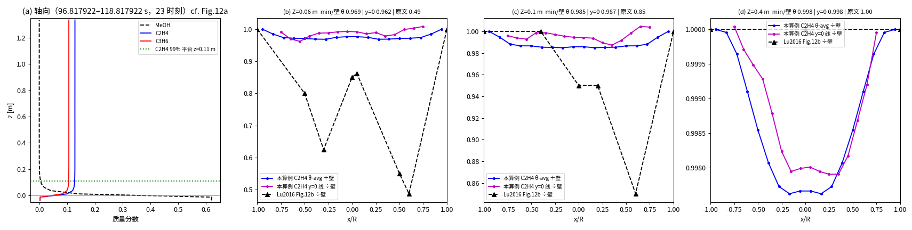
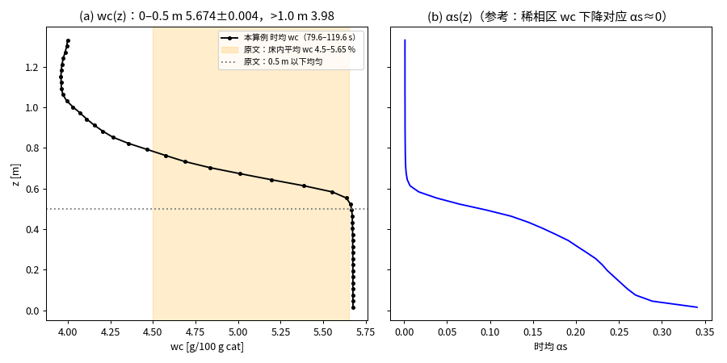
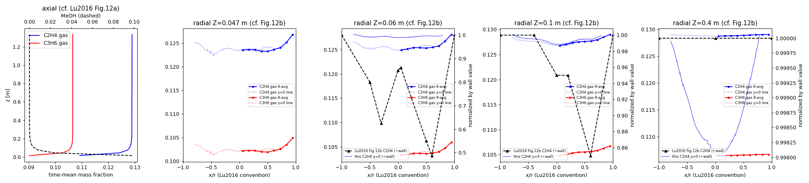
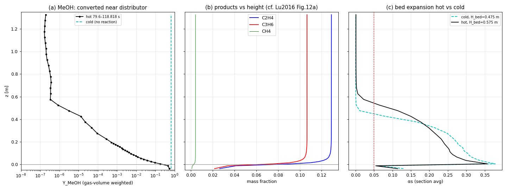

# Lu et al. (2016) CES 143:341-350 中试 DMTO 反应器 3D 复现报告
生成：2026-11-04 13:52:03

## 1 算例
- 3D 完整几何（Fig.1）：提升管 D0.068 L3.35 + 水平蒸汽支管(1) + 进气室 + 5 % 多孔板 + 主区 D0.261 H1.347 + 锥 + 沉降段 D0.59 + 顶锥 + 出口(5)；入口(3) 沉降段侧壁，出口(4) 提升管底
- 网格：384026 单元（snappyHexMesh），主区 226464 单元、平均 68.9 dp
- 多孔板：开孔率 5.00 %，211 个开孔面
- 模型：reactingTwoPhaseEulerFoam；EMMS/bubbling 曳力（自写 libEMMSbubblingDrag，HD 单元测试通过）；KTGF 代数 Θ、Lun 颗粒压力、Gidaspow 粘度、Schaeffer φ=30°、packing 0.63/0.61；等温 738 K；7 集总动力学（Table 3），气相与焦炭源项同为 αsρs(1−Y_coke) 基准

## 0 与原文逐项对照（总表）

| 项目 | 本算例 | 原文 CFD | 实验 | 相对原文 CFD | 受初值主导？ | 结论 |
|---|---|---|---|---|---|---|
| ηMeOH %（z=1.0 m，主） | 100.0000 | 99.97 | 99.94 | +0.03 % | 否 | 对上 |
| ηMeOH %（outlet5） | 96.76 | 99.97 | 99.94 | -3.22 % | 冷态残留 MeOH 主导 | 未对上（已解释） |
| C2H4/C3H6（z=1.0 m） | 1.2101 | 1.2096 | 1.2449 | +0.04 % | 间接（取决于 wc） | 对上 |
| S(C2+C3) %（z=1.0 m） | 80.82 | 80.69 | 77.60 | +0.16 % | 间接（取决于 wc） | 对上 |
| wc %（主区 αs 加权） | 5.660 | 5.655 | 6.0 | +0.10 % | 是（≈初值 5.662） | 不能作证据 |
| Fig.10 wc(z)：0–0.5 m | 均匀 5.674（极差 0.007） | 0.5 m 以下均匀 | — | — | 是 | 形状对上 |
| Fig.10 wc(z)：>1.0 m | 3.98 | 0.5 m 以上下降 | — | — | 部分 | 形状对上 |
| Fig.11/12a 反应完成高度 | C2H4 99 % 平台 z=0.11 m | 约 0.2 m 以下完成 | — | 偏低 | 否 | 定性对上，偏早 |
| Fig.12b Z=0.06 m min/壁（y=0 线） | 0.962（x/R -0.55） | 0.49 | — | 凹陷深度约差 13 倍 | 否 | 未对上（ANA-3D-009） |
| Fig.12b Z=0.1 m min/壁 | 0.987 | 0.85 | — | 偏浅 | 否 | 未对上 |
| Fig.12b Z=0.4 m | 平（0.998） | 平（1.00） | — | — | 否 | 对上 |
| 冷态 Δp/床重 | 0.961 | 理论≈1 | — | -3.9 % | 否 | 对上 |
| 热态 Δp/床重 | 0.957 | — | — | — | 否 | 与冷态一致 |
| 床高 冷态 → 热态 | 0.475 → 0.575 m | 原文未给数值 | — | 热态膨胀 21 % | 否 | 定性合理 |

综合比对图：`compare_paper.png`（tools/compare_paper.py 生成，数据表同 compare_paper.md）。
数值敏感性（NUM-3D-006）：np32、Co0.6 相对基准 np64，z=1.0 m 的 C2H4/C3H6、S、ηMeOH 偏差 <0.001 %，烃流量偏差 <0.03 %（小于 95 % CI）；B Co0.25 仍在算。

注：床高按 αs=0.05 判据；cold_check.json 中 0.6 m 为另一判据（αs 降至稀相值），两者不可混用。

## 2 冷态验证（独立于 CSTR 初值）
- 床层压降 1622.6 Pa vs 床重/截面 1685.8 Pa（-3.7 %）
- 床高 0.6 m；密相 αs 0.273；截面 αs 时间变异系数 0.092（有气泡结构）
- 图：cold_as_15.6192.png / cold_as_19.6192.png / cold_asMean.png / cold_dp.png

## 3 热态 KPI（统计窗见下）
窗口 [79.6192, 118.817922]，样本 11036

| KPI | 本算例 | 实验 | 原文 CFD | 相对实验误差 |
|---|---|---|---|---|
| C2H4_C3H6 | 1.2108 | 1.2449 | 1.2096 | -2.74 % |
| wc_pct | 5.6605 | 6.0 | 5.655 | -5.66 % |
| S_C2C3_pct | 80.808 | 77.6 | 80.69 | 4.13 % |
| eta_MeOH_pct | 96.7557 | 99.94 | 99.97 | -3.19 % |

### 主 KPI（z=1.0 m 床层出口）vs outlet5
| 量 | z=1.0 m（主） | outlet5 | 原文 CFD |
|---|---|---|---|
| ηMeOH % | 99.99996 | 96.756 | 99.97 |
| C2H4/C3H6 | 1.2101 | 1.2108 | 1.2096 |
| S(C2+C3) % | 80.82 | 80.81 | 80.69 |
| MeOH kg/h | 6.91e-06 | 0.584 | — |

outlet5 的 MeOH 来自冷态 0–19.6 s 积存于沉降段/稀相的未反应进料，随停留时间衰减（NOTE-3D-006），不代表床层转化。

### 热态 vs 冷态
| | 窗口 s | Δp Pa | Δp/床重 | 主区藏量 kg | 床高 m |
|---|---|---|---|---|---|
| 冷态 | 15–19.62 | 1616±32 | 96.1 % | 9.17 | 0.475 |
| 热态 | 79.6192–119.618517570197 | 1608±23 | 95.7 % | 9.17 | 0.575 |

### 进气室反应屏蔽（DEV-3D-005）状态
状态更新（2026-11-02 00:50–10:11，t≈83.4–94.0 s）：第 6–15 次 60 分钟未回复（约每小时一次）；推荐方案 1 需停止 33556dec，属例外，均未执行；维持默认口径 3，问题保留。
若未执行：Fig.12/分布器附近分布类结果作废，仅出口 KPI 有效；"用户未回复"时未按推荐方案停机（推荐方案需停运行中作业，属例外）。

### KPI 可信度（kpi_credibility）
kpi_credibility 3 次（2026-11-03，全部 passed=true）
反应开启 t=19.6192 s；主统计窗 79.6192–118.8179 s（最后一个写出时刻；119.619 s 未整除 writeInterval 未写出，监测 .dat 到 119.619 s）

[1] z=1.0 m 截面（床层出口，主 KPI），τ_bed≈1 s，窗口起点已过 60 τ：
    ηMeOH 99.99996 %（原文 CFD 99.97，+0.03 %）；C2H4/C3H6 1.2101（1.2096，+0.04 %）；S(C2+C3) 80.82 %（80.69，+0.15 %）
[2] outlet5（反应器出口），τ_res≈25.6 s（冷态残留 MeOH 冲刷），窗口起点 = 反应开启后 60 s = 2.3 τ：
    ηMeOH 96.76 %（-3.21 %，残留主导；末时刻反应器内 MeOH 仅 1.73 g）；C2H4/C3H6 1.2108（+0.10 %）；S 80.81 %（+0.15 %）
[3] 敏感性窗口 96.82–118.82 s（进气室屏蔽 t_sw=94.818 s 后 +2 s）：
    z1：ηMeOH 99.99994 %，C2H4/C3H6 1.2054（-0.35 %），S 80.71 %（+0.03 %）；outlet5 ηMeOH 97.72 %
    → 屏蔽前后出口 KPI 差异 <0.4 %，出口 KPI 不受进气室反应影响。

初值主导判定：
  · wc 5.6605 % ≈ 初值 5.662 %（CSTR）→ 初值主导，不能作复现证据（焦炭松弛时间 Is/Gs≈1 h ≫ 100 s）。
  · C2H4/C3H6 与 S(C2+C3) 工具判为"可作证据"，但它们由 738 K 动力学在 wc≈5.66 % 下的选择性决定，
    同样间接受 wc 初值约束；它们说明的是"完全转化 + 动力学实现正确"，不是独立的流体力学验证。
  · 对流场敏感的独立证据：冷态压降/床高、热态床层膨胀、MeOH 轴向衰减（0.2 m 内完成）、Fig.12 径向形状（见报告第 4 节）。


**说明**：wc 与 C2H4/C3H6 的松弛时间（固体停留时间 Is/Gs≈1 h；焦炭对 MeOH 进料的响应时间同量级）远大于模拟时长 100 s，其吻合主要来自 CSTR 初值（wc0=5.662 %），不能单独作为 CFD 正确性证据。独立验证依据：冷态压降/床高/气泡结构、ηMeOH、床层内 MeOH 与产物轴向分布、分布器附近径向分布。

### 敏感性对照：进气室屏蔽后窗口（t_sw+2 s → 末）
窗口 [96.817922, 118.817922]
- z=1.0 m：ηMeOH 99.99994 %，C2H4/C3H6 1.2053，S(C2+C3) 80.71 %
- outlet5：ηMeOH 97.723 %，C2H4/C3H6 1.2104

## 4 空间分布（Fig.10/11/12 对照）
数据：23 个写出时刻（96.817922–118.817922 s）瞬时场算术平均；绝对值含 CO2 稀释差异（NOTE-3D-008），只比形状
- 轴向（Fig.12a）：C2H4 达 99 % 平台高度 z = 0.11 m（原文约 0.2 m 内完成）

| Z m | θ 平均 min/壁 | y=0 线 min/壁（谷位 x/R） | 原文 Fig.12b min/壁 | θ 平均 W 形 |
|---|---|---|---|---|
| 0.06 | 0.969 | 0.962（-0.55） | 0.49 | False |
| 0.1 | 0.985 | 0.987（+0.35） | 0.85 | False |
| 0.4 | 0.998 | 0.998（+0.25） | 1.00 | False |



- Fig.10 焦炭：0–0.5 m 时均 wc 5.674 %（极差 0.007，均匀），>1.0 m 3.98 %，主区 αs 加权 5.660 %（原文：0.5 m 以下均匀、以上下降，床内平均 4.5–5.65 %）







## 5 偏离与数值处理（deviations.log.md 全文）

```
# 偏离记录 — pilot3D（3D 按原文复现 Lu et al. 2016 CES 143:341-350）
# 只记真实存在的偏离 / 原文未给需补值的项；2D 方案的偏离见 cases/pilot2D/deviations.log.md

[DEV-3D-001] 颗粒恢复系数 e 原文未给 → 取 0.9（Fluent 15 默认值）。
  来源：2016 Table 2 Eq.(J)/(L)/(M) 中出现 e，Table 4 未列数值。
  user_approved: yes（任务描述明示）

[DEV-3D-002] 原文未给尺寸、按 Fig.1 读图补值（几何拓扑与原文一致，非降维/删件）：
  - 进气室高 0.05 m、直径 0.261 m（VLM 估 30–60 mm）
  - 蒸汽支管(1) 截面 10×10 mm（≈1e-4 m2）、长 0.15 m（VLM 估 110–200 mm），水平 -x 向
  - 新鲜剂入口(3) 位于沉降段侧壁最下沿（紧贴锥顶），+x 侧，面积 0.000144 m2（Table 1）按 1 周向段×9.9 mm
  user_approved: 任务描述要求"读不准用 vision_analyze 读图并标读图值"，已在 lock 文件标注

[DEV-3D-003] 新鲜剂入口(3)网格面积 1.20e-4 m²（Table 1：1.44e-4 m²，-17%）。
  原因：入口 3 局部加密由 L4(1.75 mm) 降到 L2(7 mm)。L4 下入口单元 |Us| 达 60–90 m/s，Ur-Courant 把 Δt 压到 ~1e-5 s，100 s 要 20+ 天。
  处理：保持 αs=0.4、wc=2 %、8.8 kg/h 不变，按实际面积反算 Us=0.0339 m/s（原 0.0284）。
  影响：入口动量通量 +20 %，量级 ~1e-3 Pa，对床层流体力学可忽略。属数值离散偏离，未改论文物理量。

[NUM-3D-001]（数值处理记录，非论文值偏离）outlet5 边界类型：
  p_rgh prghPressure → prghTotalPressure(p0 = 125325 Pa，表压 0.024 MPa 不变)；alpha.particles zeroGradient → inletOutlet(回流 0)。
  原因：t≈0.1756 s 顶锥出口相邻单元出现回流射流 Ug 16→58 m/s 指数增长 → kineticTheory sigFpe。修后冒烟 0.4 s，dt 稳定，U 最大值不再增长（foam_locate 复核）。

[NUM-3D-002]（配置错误修正，非论文偏离）重力方向：constant/g 从 pilot2D 拷来为 (0 -9.81 0)，3D 几何竖直轴为 z。
  影响：重力横向 → 床层被甩向 -y 侧壁（t=0.9 s 主区 y>0 半边 αs=0.0004，y<0 半边 0.2227），顶锥/出口出现侧向回流；
        之前 outlet5 回流发散很可能与此有关。
  修正：g = (0 0 -9.81)；其它字典（setFields/topoSet/monitors）已核对均按 z 竖直；hRef 默认 0。
  作废：此前全部冷态结果（0–0.4 s 冒烟、0.4–1.12 s 续算、0–0.1756 s 崩溃算例）作废，已删除，从 t=0 重新 setFields 重跑。
  保留：outlet5 BC 修改（NUM-3D-001）保留，修 g 后重新观察其必要性。

[NUM-3D-003]（数值设置）g 修正后真实重力下床层压实，maxCo=1（含 smoothLimiter 0.1）在 t≈0.083 s 出现 αs 越过 packing 0.63 → 0.99 → ρ/ν 除零崩溃。
  改回 maxCo=0.4（与 pilot2D_emms 跑通设置一致），Δt≈6–8e-5 s（仍 < 原文 5e-4 上限）。
  Yi 求解器：稀相下 coke 方程 1000 次迭代不收敛 → relTol 0.01、maxIter 50、residualAlpha 1e-4。
  冒烟 0–0.5 s（g 修正后）：四方位固含对称（0.178–0.180），床层 z∈[0,0.3]，αs_max 0.6216，U 最大值不增长 → 通过。

[NUM-3D-004]（数值设置）t=0.8395 s 单个 PIMPLE 外迭代内 αs_max 0.629→1.48（alpha 求解 166 次迭代），随后 p_rgh 残差=1、除零崩溃。
  定位：foam_locate 0.70–0.82 s 各场最大值不增长，属于突发 MULES 过冲，不是边界持续发散。
  修正：alpha nAlphaSubCycles 2→3，smoothLimiter 0.1（官方 fluidisedBed 教程值）。从 0.8192 s 续算越过崩溃点到 1.2 s 稳定。
  代价：速度 1.19 → 0.95 物理 s/h。

[DEV-3D-004] 多孔板漏料（原文 Fluent 同为 5 % 开孔多孔板简化，原文未报告漏料情况）。
  孔速：27 kg/h / 0.4288 kg/m³ / 开孔 0.00244 m² = 7.2 m/s（低于常用防漏经验值约 10 m/s）。
  时序（plenumchk.py，0.5–19.6 s）：进气室藏量 0.02 → 0.36 kg，约 5 s 后饱和，5–19.6 s 稳定在 0.35–0.37 kg；
    进气室底层（-0.05<z<-0.04，inlet2 上方）αs 稳定约 0.14，没有持续增长或堵塞 inlet2。
  占比：总藏量 19.76 kg 的 1.8 %，主区藏量约 9.2 kg 的 4 %（<5 % 阈值）。
  处理：按用户标准（稳定且 <5 %）记录后继续，不改板。影响：进气室内颗粒在热态会参与反应（MeOH 进入床层前预转化一部分），
    这一点在分析 Fig.11/12 分布器附近 W 形分布时需要说明。

[NUM-3D-005]（运行事故）热态 82e1e16c 在 t=21.08 s 被中断：运行中向 monitorsHot 追加 surfaceFieldValue(weightField alphaRhoU)，
  runTimeModifiable 重读时字段不存在 → FATAL 杀掉全部 64 进程。已改为 coded functionObject speciesZ1（z=1.0 m 层组分通量），
  先在 /tmp/ab_fo 32 核副本验证通过，再从 20.6192 s 续算（runId 33556dec）。损失约 0.46 s 物理时间，场与反应设置不变。
  教训：运行中算例的字典改动必须先在副本验证。

[NOTE-3D-006] 热态启动方式说明（非偏离，影响 KPI 统计窗选择）：冷态 0–19.6 s 入口(2) 一直通 MeOH/H2O（未开反应），
  开反应时反应器内已充满未反应 MeOH（沉降段+锥 <Y_MeOH>=0.43，0.35 m³）。开反应后床层 6 s 内转化近完全（z=1.0 m 截面
  MeOH 0.001 kg/h），但出口(5) 的 MeOH 在 26.9 s 仍为 12 kg/h（残留冲刷，τ≈25 s 指数衰减）。
  → outlet5 的 ηMeOH/产物 KPI 必须在 ≥2.5τ 之后统计（79.6–119.6 s 窗口时残留约 9 %→3 %）；z=1.0 m 截面 KPI 作为对照。
  原文按 60 s 后平均 40 s，与本窗口一致。
  残留盘点（tools/meohres.py，2026-11-01）：反应器内气相 MeOH 16.10 g（60.6 s）→ 9.70 g（73.6 s），其中沉降段 14.81→8.72 g、
    床层 0–1.0 m 仅 0.02–0.03 g → τ_res = 13/ln(16.10/9.70) ≈ 25.6 s；存量/τ ≈ 1.36 kg/h，与 outlet5 实测 1.51 kg/h（70–74.2 s）自洽。
  预估 79.6–119.6 s 窗口：outlet5 MeOH 约 1.19→0.25 kg/h，窗均约 0.6 kg/h → ηMeOH(outlet5) ≈ 96.7 %（仍是残留主导，非床层转化）；
    主 KPI 取 z=1.0 m（用户方案 1）。
  残留跟踪（meohres，2026-11-02；已修正 rd() 对 uniform 场误抓 boundaryField 的问题）：
    合计 6.15 g（84.6 s）→ 4.04 g（94.8 s）→ 3.37 g（102.8 s）；沉降段 5.50 → 3.54 → 2.32 g（τ≈19–23 s）；
    进气室 0.27 → 0.79 g（屏蔽后恢复进料组成，正常）。outlet5 MeOH 3 s 平均：90 s 0.70、96 s 0.56、102 s 0.59 kg/h，
    衰减变慢，但 z=1.0 m 截面始终约 2e-6 kg/h → outlet5 的 MeOH 来源仍是沉降段的残留，不是床层漏过。

[NOTE-3D-007] 进气室内反应：漏料（DEV-3D-004，0.36 kg）使进气室内 MeOH 已部分转化（z=-0.025 m Y_MeOH≈0.25，进料 0.667），
  分布板处 Y_MeOH≈0.06。原文未讨论进气室，Fig.11/12 的分布器附近 W 形分布对比需注明此差异。

[NOTE-3D-008] 原文 Fig.12 产物质量分数平台（C2H4≈0.081、C3H6≈0.067，含水基、估读）比本算例（0.128/0.106）低约 37 %。
  本算例值与 MeOH 18 kg/h 完全转化、加 H2O 9 kg/h 的质量衡算一致（0.128/0.106）。原文 §2.4 气相含 9 组分，含"惰性"CO2，
  但 Table 1 未给 CO2 流量；按稀释比反推，约 16 kg/h CO2 才能解释这个差异（推测，原文无据）。
  处理：不改进料（锁文件 Table 1 进料不变）；Fig.12 只对比形状（轴向 0.2 m 内完成、径向 W 形）与 C2H4/C3H6 比值，
  不比绝对质量分数。Table 6 的 KPI 已去除 H2O/MeOH/CO2，不受影响。

[DEV-3D-005]（模型修正，用户批准 2026-11-01）进气室反应源屏蔽。
  问题：多孔板漏料（DEV-3D-004，进气室约 0.25–0.36 kg 催化剂）+ fvOptions.reacting 的 mtoGas/mtoCoke 为 selectionMode all，
    源项 ∝ αsρs → 进料在进气室内已转化约 77 %（t=70.6 s：板下 Y_MeOH=0.153、C2H4=0.100，进料 Y_MeOH=0.667），
    抹平了原文 Fig.12a（z=0 处 C2H4≈0.02，0.2 m 才到平台）与 Fig.12b（Z=0.06 m W 形）的分布器特征。
  依据：原设备分布器为筛板+烧结板，催化剂不进入进气室；漏料是 5 % 多孔板简化 + 孔速 7.2 m/s 造成的数值偏差。
  修正：新建 cellZone reactZone = 全域 − 进气室环（-0.05<z<0, r>0.0345；topoSetDict.react，315413 单元）；
    mtoGas/mtoCoke 改为 selectionMode cellZone reactZone。提升管内（真实有催化剂，固含 0.6）保留反应。
    漏下的颗粒仍在流体力学上存在（藏量守恒），只是不反应。
  作废：19.62 s → 停算时刻之间的 Fig.12/分布器附近分布类结果作废（进气室提前反应）。
  不受影响：Table 6 类出口 KPI 统计窗 79.6–119.6 s 在修正后（床层出口在修正前后都完全转化）；冷态全部结果。
  实现要点（/tmp/ab_rz 验证 2026-11-01 发现）：scalarCodedSource 的 codeAddSupRho 里自写 forAll(V, c) 会遍历全部单元，
    selectionMode cellZone 对自写循环无效；必须改成 forAll(this->cells(), ic){ const label c = cells()[ic]; ... }。
    /tmp 验证 70.91→71.11 s：进气室 Y_MeOH 0.239→0.614（进料 0.667）、Y_C2H4 0.078→0.005；床底 0–0.1 m Y_MeOH 0.026→0.105；
    z=0.9–1.0 m 组分不变（Y_MeOH≈0，Y_C2H4=0.129）→ 出口 KPI 不受影响。24 核，exit 0，无 sigFpe。
  执行：writeNow 停 33556dec → topoSet → 换 fvOptions → 从最新时刻续算（脚本 tools/apply_reactzone.sh，待用户确认停机时机）。
  状态（2026-11-01 ~16:30）：用户 60 分钟未回复。推荐方案 1 需要停止运行中的 33556dec，属于"未回复默认执行"的例外，
    因此未执行；33556dec 继续按原 fvOptions（selectionMode all）运行，问题保留待用户决定。
    若在 t≈79.62 s（fieldAverage 起点）前仍未批准：79.6–119.6 s 统计窗内进气室仍有反应，Fig.12/分布器附近结果按 NOTE-3D-007 注明作废，
    出口 KPI（z=1.0 m）不受影响（/tmp 验证 z=0.9–1.0 m 组分在修正前后相同）。
  状态更新（2026-11-01 ~17:45，t≈75.5 s）：第 2 次 60 分钟未回复，系统要求"按推荐方案执行"；推荐方案仍需停止 33556dec，
    属例外，再次未执行（未丢弃结果、未停作业、未改物理量），问题保留。
  中期轴向检查（axialhot 70.5–76.7 s，axial_hot70.json / axial_evidence.png，VLM 读图一致）：
    进气室 Y_MeOH 0.253（60 s 窗口 0.250）、z=0.005 m 0.061、0.2 m 1.3e-4 → 进气室反应仍在且已准稳态；
    床高 0.575 m（αs=0.05 判据，与 60 s 窗口相同）；稀相 Y_MeOH ~1e-7 的非单调属求解容差噪声。
  状态更新（2026-11-01 ~19:05，t≈77.0 s）：第 3 次 60 分钟未回复；推荐方案 1 需停止 33556dec，属例外，未执行，问题保留。
  状态更新（2026-11-01 21:43，t=80.03 s）：第 4 次 60 分钟未回复，推荐方案仍需停作业，未执行。
    fieldAverage 已于 79.6192 s 开始，统计窗 79.6–119.6 s 按原 fvOptions（selectionMode all，进气室有反应）进行。
    当前默认口径 = 选项 3：z=1.0 m 出口 KPI 有效；Fig.12 / 分布器附近分布类结果作废。用户之后若选 1，需重开统计窗（与"不延长"冲突，届时再申报）。
  状态更新（2026-11-01 ~23:45，t≈82.3 s）：第 5 次 60 分钟未回复；推荐方案 1 需停止 33556dec，属例外，未执行；维持默认口径 3，问题保留。
  状态更新（2026-11-02 00:50–10:11，t≈83.4–94.0 s）：第 6–15 次 60 分钟未回复（约每小时一次）；推荐方案 1 需停止 33556dec，属例外，均未执行；维持默认口径 3，问题保留。
  【已执行 · 用户批准执行】2026-11-02 ~10:50：用户书面批准（"writeNow 停 → topoSet → 换 fvOptions → 续算"），DEV-3D-007 作废。
    切换时刻 t_sw = 94.817922 s（writeNow；64/64 processor 写全，含 *Mean 与 uniform）。33556dec exit 0。
    topoSet reactZone 315413 单元（体积 0.43583 m³）；fvOptions 两处 selectionMode cellZone reactZone + codeAddSupRho 遍历 this->cells()；
    log.hot3 确认 mtoGas/mtoCoke "selected 315413 cell(s)"；原文件留档 constant/fvOptions.bak_all（= fvOptions.reacting）。
    续算 runId 31fb3751，命令与 33556dec 相同，endTime 119.619 不变；fieldAverage speciesMean 续累计（iters 231320，15.2 s）。
  统计口径（用户指定）：
    · 出口 KPI 主窗口仍为 79.6–119.6 s（切换前后床层出口均完全转化）。
    · 敏感性对照：另报 t_sw+2 s ≈ 96.82 → 119.6 s 窗口。
    · Fig.12 / 分布器附近分布类结果只用 t ≥ t_sw+2 s 的数据；speciesMean 跨越切换时刻，不能用于 Fig.12，改用 96.8–119.6 s 写出时刻的瞬时场做算术平均。
  切换后检查（瞬时场，t_sw → t_sw+1 s = 95.818 s）：
    进气室 Y_MeOH 0.251→0.662（进料 0.667）、Y_C2H4 0.080→0.0002 → 屏蔽生效；
    z=0.005 m Y_MeOH 0.046→0.212，Y_C2H4 0.119→0.087（分布板处开始出现原文 Fig.12a 的低产物区）；
    z=0.9–1.0 m Y_MeOH 0.0000、Y_C2H4 0.1295 不变 → 出口 KPI 不受影响；
    z=0.06 m θ 平均 C2H4(r)：切换前单调升（0.121→0.129）；切换后中心 0.1280、0.5R 0.1229、壁 0.1238，
      中心比 0.5R 高 4.1%，近壁只回升 0.7%（<3% W 判据）→ t_sw+1 s 时为"中心高的 V/半 W 形"，t_sw+2 s 后复核。
  t_sw+2 s = 96.818 s 复核（tools/swcheck.py → swcheck.json）：
    进气室 Y_MeOH 0.662、Y_C2H4 0.0001；z=0.005 m Y_MeOH 0.203；z=0.9–1.0 m Y_MeOH 0.0000、Y_C2H4 0.1294（不变）；
    z=0.06 m C2H4(r)：0.1252 / 0.5R 0.1173 / 壁 0.1281 → 中心 +6.7%、壁 +9.2%（相对 0.5R）→ W 形成立；C3H6 同（+6.7% / +9.1%）。
    → 与原文 Fig.12b Z=0.06 m 定性一致（W 形）；切换前该平面为单调分布，不是 W 形。
  中期 Fig.12 对照（tools/fig12post.py，96.8/97.8/98.8 s 三时刻平均 → fig12_post.png/json，VLM 读图一致）：
    轴向：进气室 MeOH ≈0.62，C2H4 在 z=0.14 m 达到 99 % 平台（原文 Fig.12a "约 0.2 m 内完成"，一致）。
    径向 C2H4 min/壁：Z=0.06 m 0.958（W 形，谷 ±0.5R）/ 0.1 m 0.977 / 0.4 m 0.997 → 随高度单调变浅，0.4 m 消失，与原文趋势一致。
    差异：凹陷深度本算例约 4 %，原文约 51 %（0.49）。原因可能有三：① 本算例用 θ 平均（周向平均抹平孔射流），原文为 Y=0 平面上的线；
      ② 原文含 CO2 稀释，绝对值不可比（NOTE-3D-008）；③ 只平均了 3 个瞬时场。Fig.12b 只做定性（形状、谷位、随高度衰减）对比。
    图中蓝线左右对称是因为 θ 平均后做了镜像，不代表流场对称。
    补充 y=0 线（与原文同口径，96.8–99.8 s 四时刻平均）：min/壁 Z=0.06 m 0.906（x/R=−0.55）、0.1 m 0.958（−0.55）、0.4 m 0.997。
      比 θ 平均（0.962）深一倍，谷位 −0.55 与原文 +0.6/−0.3 处于同一量级；深度仍比原文 0.49 浅，结论不变（只比形状）。

[ANA-3D-009] Fig.12b 径向凹陷深度偏差根因分析（2026-11-03，只做分析，未启动计算）
  现象：Z=0.06 m C2H4 min/壁 本算例 0.962（y=0 线，96.8–118.8 s 切换后 23 时刻平均；θ 平均 0.969），原文约 0.49；
    Z=0.1 m 0.987 vs 0.85；Z=0.4 m 0.998 vs 1.00。凹陷随高度衰减的趋势和 0.4 m 处变平一致，深度约差 13 倍。
    轴向 C2H4 99 % 平台 z=0.11 m（原文 "0.2 m 以下完成反应"）→ 本算例转化更快、更靠近分布板。
  可能原因按"是否属于分布器未知量"分两类：
  A. 分布器未知量（原文没有给出，本算例按假设补值）
    A1 开孔方式：原文只写"5 % 开孔多孔板"（§2.4），孔数/孔径/布孔未给。本算例 211 个孔、平均 11.6 mm²（d≈3.8 mm）、均匀环形布置。
       孔数越少、孔径越大，单孔射流越强、穿透越深，Z=0.06 m 平面内"射流芯（高 MeOH、低产物）"与"孔间区"的差异越大 → 凹陷越深。
       这是对 min/壁 影响最大的单一因素。
    A2 孔速：由开孔率和进料决定，为 7.2 m/s（DEV-3D-004）。开孔率一定时，孔速已确定，但射流动量通量 ∝ 孔速²×单孔面积，仍取决于 A1。
    A3 进气室高度（0.05 m，读图值，DEV-3D-002）与 inlet2 位置 → 板下流量在各孔间的分配，影响 W 形的左右不对称（原文谷位 +0.6/−0.3 不对称）。
    A4 中心开口区（提升管口 r<0.034）的边界：影响 r≈0 处的峰值。
  B. 非分布器因素
    B1 CO2 稀释（NOTE-3D-008）：只改变绝对值；"÷壁"归一化后对 min/壁 的影响为二阶，不能解释 13 倍的差异。
    B2 漏料（DEV-3D-004）：t_sw 前进气室有反应，使板下 MeOH 降到 0.25，抹平了径向差异；t_sw 后屏蔽已排除（板下 Y_MeOH 0.662）。
       但漏下的颗粒仍会在板下改变气流分配（流体力学上的影响仍在）。
    B3 网格分辨率（mesh_stats.json）：进气室平均 h=3.52 mm、板上 0–0.05 m 带 4.25 mm、Z=0.06 m 所在主区 6.69 mm；
       孔径约 3.8 mm，射流核心不足 1 个单元 → 射流被数值扩散抹平，凹陷变浅。
       原文 2017 年给出"分布器附近约 6.3 万单元"，本算例（进气室 + 板上带）共 8.5 万，同量级；原文对孔的分辨方式未知。
    B4 统计方式：原文是 Y=0 平面上的时均线；本算例 y=0 线取 |y|<h/2 的一层单元、x 分 20 个箱平均，会再抹平一些。
    B5 反应速率：738 K 动力学与原文一致（Table 3 插值）；轴向平台更早到达（0.11 vs 约 0.2 m）说明本算例床底的气固接触更好或射流更早被打散，
       与 B3（射流被抹平 → 气体更早进入乳化相）方向一致。
  结论：深度差异的主因判断为 A1（布孔未知）+ B3（射流未解析），两者都作用在"单孔射流的强度与穿透"上，难以分开；
    B1、B4 是次要因素；B2 已通过屏蔽排除了化学部分。出口 KPI 对这些因素不敏感（屏蔽前后差 <0.4 %）。
  下一步方案（只提方案，未执行，需用户批准后才启动）：
    受约束反演，只把分布器未知量作为待定参数，论文已给的量（开孔率 5 %、进料、物性、动力学）全部锁定：
    · 参数：θ1 = 孔数 N_h ∈ [50, 400]（孔径由开孔率 5 % 反算，保证孔速仍为 7.2 m/s）；θ2 = 布孔方式 {均匀环、两圈同心、按 Fig.1 读图}；
      θ3 = 进气室高度 ∈ [0.03, 0.06] m（读图值的不确定范围）。
    · 目标：Fig.12b 的 min/壁（Z=0.06、0.1 m）与谷位 x/R，以及 Fig.12a 平台高度（约 0.2 m）；约束：出口 KPI 偏离原文 <1 %、冷态 Δp/床重 >0.9、漏料 <5 % 藏量。
    · 做法：先做网格无关性（板附近细化一级，h≈2.5 mm，单个孔内 ≥1.5 个单元）判断 B3 的贡献；若细化后 min/壁 仍 >0.9，再开 θ1–θ3 的 TPE 反演。
    · 每个 trial 只需热态短跑（从已收敛状态续算 5–10 s，统计后 4 s），≤32 核，估计约 6–10 h/trial，预算 12–20 个 trial。
    · 风险：反演得到的布孔是"让 CFD 对上原文 CFD"的参数，不等于真实设备，报告中需标注为标定量而非原文数据。
```
